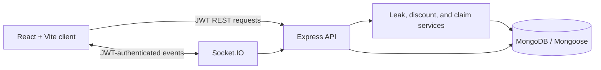

# AquaShield
## Smart Home Water-Leak Parametric Insurance

**Project type:** Internship project prototype  
**Prepared by:** _Add your name_  
**Organization:** _Add company name, if required_  
**Date:** 19 November 2026

## Executive summary

AquaShield demonstrates how connected-home telemetry can support earlier water-leak awareness and a more transparent insurance-claim workflow. A homeowner can register a property, connect a virtual device, inspect synthetic sensor readings, run leak scenarios, review sample policies, and follow the resulting incident and claim decisions. An administrator can inspect records, review ambiguous claims, configure bounded sample-plan parameters, and view an audit trail.

The application is a working local prototype. Device readings, valve commands, sample insurance terms, claim decisions, and payout references are simulated. No hardware, insurer, bank, or payment provider is connected.

## Problem and objectives

Water damage can be difficult to detect early, and insurance processes can be difficult to understand. This prototype explores a connected workflow that:

- Presents flow, pressure, moisture, device health, and incident history together.
- Applies explainable rules to distinguish normal readings, suspected leaks, and higher-severity events.
- Demonstrates automatic shutoff for serious simulated events and requires explicit acknowledgment before reopening.
- Calculates sample monitoring discounts and parametric claim outcomes on the server.
- Shows the evidence, policy checks, payout calculation, review status, and audit history.

## Delivered capabilities

### Homeowner experience

- Account registration, login, logout, profile, property registration, and virtual-device linking.
- Dashboard with sensor telemetry, device health, valve state, sample-policy summary, incidents, claims, and notifications.
- Interactive presets for normal operation, small leak, major leak, pipe burst, sensor failure, and offline device.
- Live telemetry updates through authenticated Socket.IO connections.
- Sample-plan comparison and policy activation with a server-calculated eligibility breakdown.
- Claim detail with sensor evidence, rule-by-rule evaluation, status history, and a printable receipt.

### Administrator experience

- Role-protected summary of users, devices, incidents, policies, claims, and simulated payouts.
- Manual review and audited approve/reject decisions for claims that need review.
- Read and manage demo users, devices, and policies.
- Bounded editing of demo-plan premiums, triggers, discounts, limits, deductibles, and waiting periods.
- Audit log for administrative and policy/device actions.

## Architecture

| Layer | Implementation |
|---|---|
| Client | React, Vite, React Router, Axios, Tailwind CSS, Recharts, Lucide, Framer Motion, React Hook Form, Zod, React Hot Toast |
| API | Node.js, Express, request validation, rate-limited authentication, JWT role/ownership middleware |
| Persistence | MongoDB and Mongoose for users, properties, devices, readings, incidents, plans, policies, claims, payouts, notifications, and audit logs |
| Real-time | Socket.IO with authenticated user-specific rooms |
| Rules | Server-side leak analysis, discount eligibility, waiting-period and trigger checks, payout caps, and idempotent demo transaction creation |

## Key decision flow

1. A selected simulator preset produces synthetic sensor telemetry and persists the reading.
2. The leak service checks flow anomalies, persistent elevated flow, pressure drops, and moisture.
3. A serious incident can close the virtual valve and creates an incident and notification record.
4. If there is an active policy for the property, claim rules check policy inception, waiting period, telemetry reliability, plan thresholds, exclusions, deductible, and caps.
5. Eligible lower-risk claims can be automatically approved and recorded as a simulated payout. Critical or ambiguous claims go to administrator review; failed checks are not automatically paid.
6. Unique database indexes and incident deduplication prevent duplicate incidents, claims, and payout records.

All numerical thresholds and insurance terms are demonstration values. They are not certified plumbing guidance or real insurance terms.

## Local demonstration

The full installation, environment configuration, seed, and startup steps are in the [README](README.md). After setup, the repeatable demonstration is:

1. Log in as the homeowner and inspect the seeded property, policy, normal reading, and sample paid claim.
2. In **Device simulator**, select **Major leak** and verify the recorded incident and automatic virtual shutoff.
3. Open **Claims & activity** to inspect trigger checks and the simulated payout.
4. Select **Pipe burst** to create a critical event for manual review.
5. Log in as the administrator to inspect and decide the review item; verify the audit log.
6. Try reopening the virtual valve without confirmation, then use the acknowledgment and safety-confirmation flow.

### Demo accounts

| Role | Email | Password |
|---|---|---|
| Homeowner | `homeowner@aquashield.demo` | `AquaDemo123!` |
| Administrator | `admin@aquashield.demo` | `AquaDemo123!` |

These are seeded local demonstration accounts only. Do not reuse their credentials in a shared or production environment.

## Verification performed

- Backend automated tests cover normal and anomalous readings, persistent flow, discount caps and eligibility, policy and trigger checks, ambiguous claim review, role authorization, and idempotency constraints.
- Production client build completes successfully.
- Local MongoDB/API checks exercised authentication, incident creation, automatic valve closure, claim and simulated payout flow, duplicate-event suppression, ownership enforcement, admin review, bounded plan validation, and unsafe valve-reopen rejection.
- Production dependency audits completed with no reported vulnerabilities.

For exact routes and example requests, see the [API documentation](server/API.md).

## Scope and limitations

- This prototype does not connect to physical sensors, shut-off hardware, an insurer, or any payment service. `SIMULATED_PAID` means a database record only.
- Synthetic data and plan terms are not suitable for underwriting, financial advice, emergency response, or real coverage decisions.
- Local demo authentication stores a JWT in browser storage. A production deployment would require a security review and hardened session management, secure transport, secrets management, privacy controls, and monitoring.
- Production use would also require validated hardware integrations and fail-safe behavior, legal and actuarial review of policy terms, provider integrations, operational support, and broader automated integration/security testing.
- The seed credentials and sample financial values are intentionally public fixtures.

## Suggested review checklist

- [ ] Replace the submission name and organization fields above if required.
- [ ] Confirm the organization’s project format, repository-sharing policy, and any required attribution.
- [ ] Run the local setup and demo flow before presenting.
- [ ] Keep the simulation and no-real-payout limitations visible during the demonstration.
